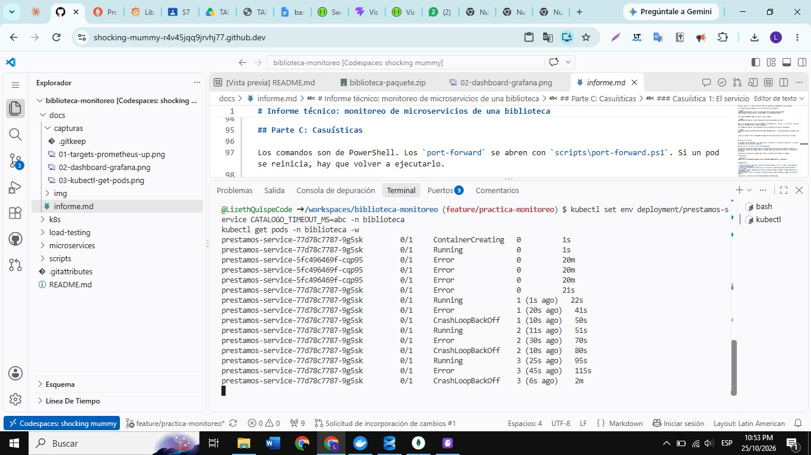
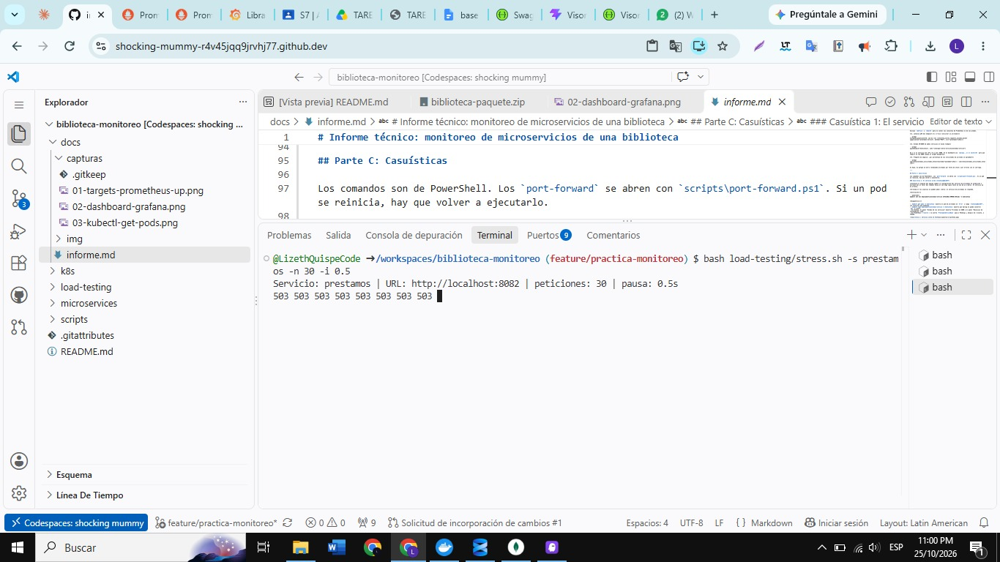
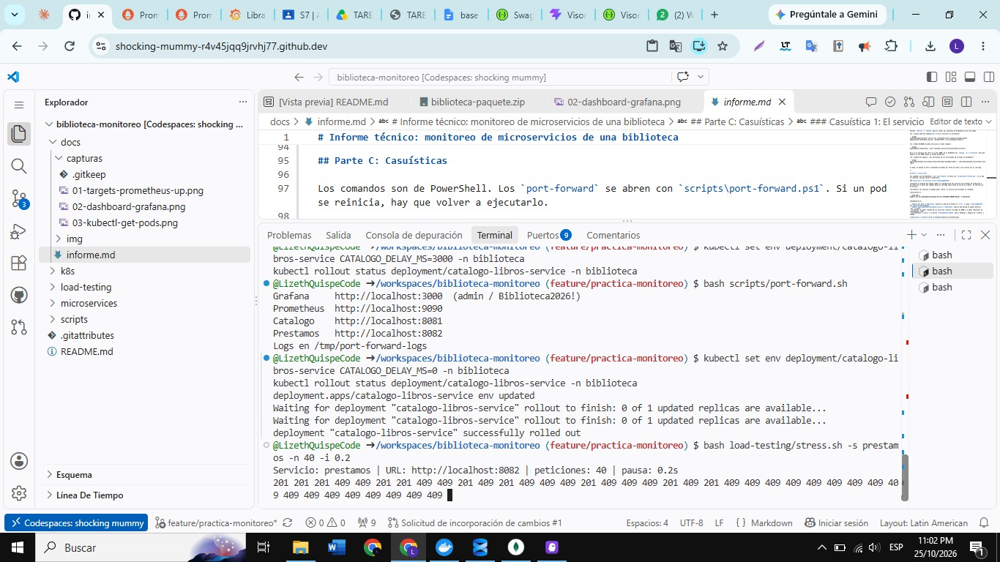
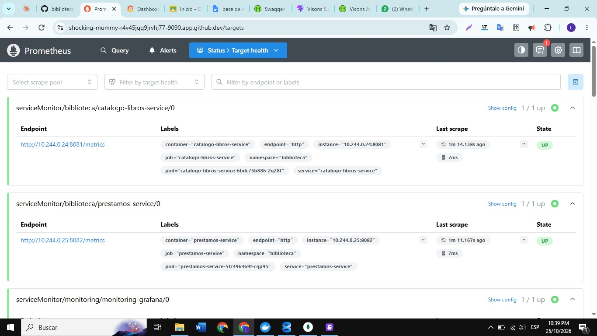
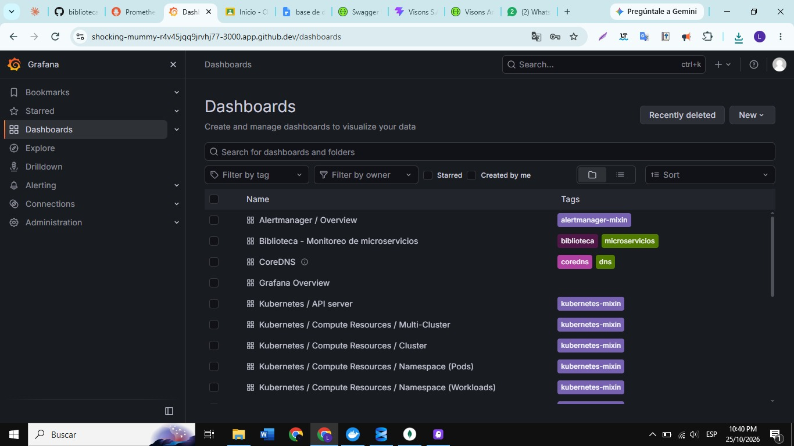
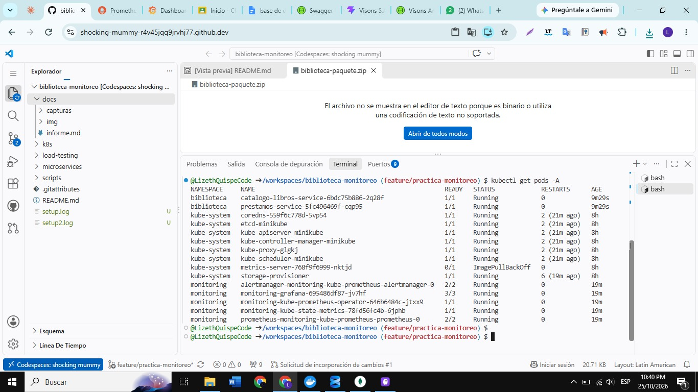
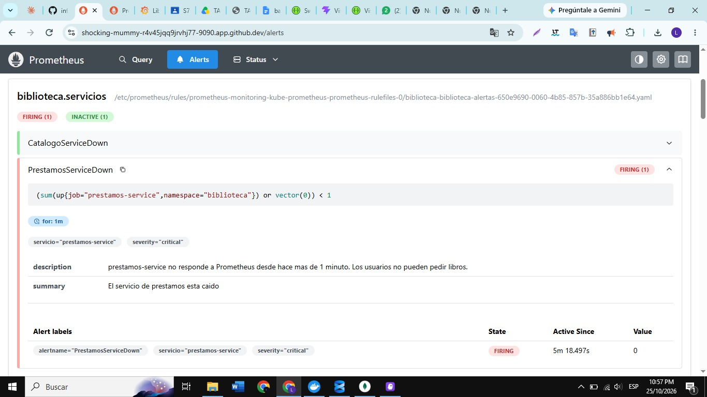

# Informe técnico: monitoreo de microservicios de una biblioteca

**Autora:** Lizeth Yasuri Quispe Suarez
**Curso:** Kubernetes con Prometheus & Grafana, Valle Grande
**Repositorio:** https://github.com/LizethQuispeCode/biblioteca-monitoreo

## Mi sistema

Elegí el dominio de una biblioteca con dos servicios:

- **catalogo-libros-service (Servicio A, puerto 8081):** guarda los libros y su stock en memoria.
- **prestamos-service (Servicio B, puerto 8082):** registra los préstamos. Antes de aprobar uno le pregunta al catálogo si el libro está disponible y después le pide reservarlo. Si el catálogo no responde en 2 segundos, el préstamo se rechaza con un 503 y el error se registra.

Los dos corren en el namespace `biblioteca` de Minikube. Prometheus, Grafana y Alertmanager están en el namespace `monitoring`, instalados con el chart `kube-prometheus-stack`.

El dashboard está en `k8s/dashboards/biblioteca-dashboard.json` (11 paneles) y las alertas en `k8s/prometheusrule.yaml` (5 alertas).

---

## Parte A: Conceptos

### 1. ¿Qué es Micrometer y por qué se usa en lugar de la librería directa de Prometheus?

Micrometer es una capa común para registrar métricas desde el código. Funciona parecido a SLF4J con los logs: yo escribo mis métricas contra la interfaz `MeterRegistry` y después una dependencia las convierte al formato del sistema de monitoreo. En mi proyecto uso `micrometer-registry-prometheus`, que las publica en `/metrics` en el formato que lee Prometheus.

Prefiero Micrometer porque mi código no queda atado a Prometheus. Si mañana usaran otro sistema, cambiaría la dependencia y no las clases. Además Spring Boot Actuator ya lo trae integrado y mide solo cosas como `http_server_requests_seconds` (cantidad y duración de cada endpoint), que uso en el dashboard sin escribir código.

### 2. ¿Cuál es la diferencia entre Counter, Gauge y Timer?

- **Counter:** solo sube (o vuelve a cero si se reinicia el servicio). Sirve para contar eventos. En mi código: `registry.counter("prestamos.solicitudes", "resultado", resultado).increment()` cuenta cuántos préstamos se aprobaron o se rechazaron (en Prometheus sale como `prestamos_solicitudes_total`).
- **Gauge:** es un valor que puede subir y bajar, como una foto del momento. En mi código: `Gauge.builder("catalogo.libros.stock.total", ...)` calcula el stock total de libros cada vez que Prometheus consulta. Baja cuando se reserva un libro y sube si agrego uno nuevo. También está `catalogo.delay.artificial.ms`.
- **Timer:** mide cuánto demora algo y cuántas veces pasó. En mi código: `Timer.builder("catalogo.operacion.duracion")` mide cada operación del catálogo, y en préstamos `prestamos.catalogo.llamada.duracion` mide la llamada al catálogo. Con eso puedo calcular la latencia p95 en Grafana.

### 3. ¿Qué es un ServiceMonitor y cómo sabe el Prometheus Operator qué monitorear?

Un ServiceMonitor es un recurso de Kubernetes (CRD del Prometheus Operator) que le dice a Prometheus qué Services debe raspar. En el mío (`k8s/servicemonitors.yaml`) indico tres cosas: el `selector` con los labels del Service (`app: catalogo-libros-service`), el `namespaceSelector` (`biblioteca`) y el endpoint (el puerto llamado `http`, la ruta `/metrics` y un intervalo de 15 s).

El Operator vigila los ServiceMonitors del cluster. Cuando encuentra uno, busca los Services que coinciden con su selector, arma la configuración de scrape y recarga Prometheus. A su vez, el recurso `Prometheus` del chart tiene un `serviceMonitorSelector` que define qué ServiceMonitors toma en cuenta. Por eso el label del Service, el nombre del puerto (`http`) y ese selector tienen que coincidir.

### 4. ¿Cuál es la diferencia entre liveness probe y readiness probe?

- **Liveness:** pregunta si el contenedor sigue vivo. Si falla varias veces, Kubernetes lo reinicia.
- **Readiness:** pregunta si el pod está listo para recibir tráfico. Si falla, Kubernetes lo saca de los endpoints del Service pero no lo reinicia.

En mis Deployments las dos apuntan a `/health`. La readiness empieza a los 30 segundos y la liveness a los 60, porque Spring Boot tarda en arrancar y no quiero que lo reinicien mientras todavía está iniciando.

### 5. ¿Por qué es necesario apuntar Docker al daemon de Minikube antes de construir las imágenes?

Minikube corre el cluster dentro de su propio contenedor, y ahí adentro tiene su propio Docker. Cuando Kubernetes crea un pod busca la imagen en ese Docker, no en el de mi computadora. Si construyo con el Docker normal, la imagen queda en otro lugar y los pods no la encuentran. Como mis Deployments usan `imagePullPolicy: Never`, el pod quedaría en `ErrImageNeverPull` (y con otra política intentaría bajarla de Docker Hub y fallaría, porque no existe ahí).

Por eso antes de construir ejecuto `minikube docker-env` (en PowerShell: `& minikube -p minikube docker-env --shell powershell | Invoke-Expression`), que cambia las variables de Docker para que `docker build` use el daemon de Minikube.

### 6. ¿Qué ocurre si no configuras el selector de ServiceMonitors en el values.yaml del chart?

Por defecto el chart configura Prometheus para que solo tome los ServiceMonitors (y PrometheusRules) que tengan el label `release: monitoring`, el nombre del release de Helm. Los míos están en otro namespace y no llevan ese label, así que Prometheus los ignoraría: en `/targets` no aparecerían mis servicios y las alertas no se cargarían. Todo parecería bien en Kubernetes, pero Prometheus no vería nada.

Lo resolví en `k8s/monitoring/values.yaml` con `serviceMonitorSelectorNilUsesHelmValues: false` y `ruleSelectorNilUsesHelmValues: false`, más los selectores vacíos (`serviceMonitorSelector: {}`, `serviceMonitorNamespaceSelector: {}`, `ruleSelector: {}`, `ruleNamespaceSelector: {}`) para que busque en todos los namespaces.

---

## Parte B: PromQL

**1. Tasa de requests por minuto del Servicio B en los últimos 5 minutos**

```promql
sum(rate(http_server_requests_seconds_count{application="prestamos-service", uri!~"/metrics|/health"}[5m])) * 60
```

Excluyo `/metrics` y `/health` para no contar las consultas de Prometheus ni de los probes.

**2. Latencia p95 del endpoint más crítico (solicitar un préstamo)**

```promql
histogram_quantile(0.95, sum by (le) (rate(http_server_requests_seconds_bucket{application="prestamos-service", method="POST", uri="/prestamos"}[5m])))
```

**3. Estado UP/DOWN de ambos servicios al mismo tiempo**

```promql
up{namespace="biblioteca", job=~"catalogo-libros-service|prestamos-service"}
```

Da 1 si el servicio está UP y 0 si está DOWN. En el dashboard uso `sum(up{...}) or vector(0)` para que también se vea DOWN cuando el target desaparece.

**4. Pregunta de negocio: ¿qué porcentaje de las solicitudes de préstamo se aprueban?**

```promql
sum(rate(prestamos_solicitudes_total{resultado="aprobado"}[5m])) / sum(rate(prestamos_solicitudes_total[5m]))
```

Si baja, es porque se están rechazando préstamos por falta de stock o por errores con el catálogo.

---

## Parte C: Casuísticas

Los comandos son de PowerShell. Los `port-forward` se abren con `scripts\port-forward.ps1`. Si un pod se reinicia, hay que volver a ejecutarlo.

### Casuística 1: El servicio caído (CrashLoopBackOff)

**Contexto:** alguien del equipo cambió la configuración del servicio de préstamos en producción y escribió mal el valor del timeout hacia el catálogo (puso texto en vez de un número). El servicio ya no arranca.

**Síntoma:** los usuarios no pueden pedir libros: el servicio de préstamos no responde.

**Activación:**

```powershell
kubectl set env deployment/prestamos-service CATALOGO_TIMEOUT_MS=abc -n biblioteca
```

**Diagnóstico:**

- `kubectl get pods -n biblioteca` muestra el pod de préstamos en `Error` y luego `CrashLoopBackOff`, con reinicios que aumentan.
- `kubectl logs deployment/prestamos-service -n biblioteca` muestra que Spring no puede convertir `abc` a número.
- En Grafana, el panel "Estado de los servicios" muestra Préstamos en DOWN y el panel "Reinicios de contenedores" sube.
- En Prometheus (`/alerts`) la alerta `PrestamosServiceDown` pasa a Pending y, después de 1 minuto, a FIRING.



**Resolución:**

```powershell
kubectl set env deployment/prestamos-service CATALOGO_TIMEOUT_MS=2000 -n biblioteca
kubectl rollout status deployment/prestamos-service -n biblioteca
```

**Lección técnica:** Kubernetes reinicia los contenedores que se caen, esperando cada vez más tiempo entre intentos (BackOff). La readiness probe impide que un pod que no arrancó reciba tráfico, y la liveness probe se encarga de reiniciar un contenedor que sigue vivo pero se quedó trabado. Sin métricas ni alertas, nadie se entera de que el servicio está caído hasta que un usuario se queja.

### Casuística 2: El servicio lento (timeouts)

**Contexto:** el catálogo empieza a responder lento (por ejemplo, por una consulta pesada o poca CPU). El servicio de préstamos espera máximo 2 segundos al catálogo.

**Síntoma:** al pedir un libro, el usuario espera unos 2 segundos y recibe un 503 "El catálogo no responde en este momento", aunque el servicio de préstamos está sano.

**Activación:** el catálogo lee la variable `CATALOGO_DELAY_MS` y agrega ese tiempo de espera a sus respuestas. Con 3000 ms supera el timeout de 2000 ms de préstamos.

```powershell
kubectl set env deployment/catalogo-libros-service CATALOGO_DELAY_MS=3000 -n biblioteca
kubectl rollout status deployment/catalogo-libros-service -n biblioteca
scripts\port-forward.ps1
& "C:\Program Files\Git\bin\bash.exe" load-testing/stress.sh -s prestamos -n 30 -i 0.5
```

**Diagnóstico:**

- El script muestra respuestas 503.
- En Grafana, el panel "Delay del catálogo vs timeout de préstamos" muestra el delay (3000 ms) por encima del timeout (2000 ms), y "Errores de préstamos al llamar al catálogo" muestra errores de tipo `timeout`.
- La latencia p95 del catálogo sube a unos 3 s, mientras que la llamada vista desde préstamos se corta cerca de 2 s.
- En Prometheus la alerta `PrestamosErroresCatalogo` pasa a FIRING.



**Resolución:**

```powershell
kubectl set env deployment/catalogo-libros-service CATALOGO_DELAY_MS=0 -n biblioteca
kubectl rollout status deployment/catalogo-libros-service -n biblioteca
```

**Lección técnica:** la latencia de un servicio se propaga a los que dependen de él. El servicio de préstamos parece ser el que falla, pero el problema está en el catálogo. Sin métricas por servicio y sin el gauge del delay, sería difícil saber cuál es el culpable. El timeout protege a préstamos de quedarse esperando para siempre.

### Casuística 3: Stock agotado

**Contexto:** muchos usuarios piden libros al mismo tiempo (por ejemplo, al empezar un ciclo de clases) y los ejemplares se acaban. Es una pérdida real para una biblioteca: los usuarios no consiguen el libro y no hay ningún error técnico que lo avise.

**Síntoma:** los usuarios reciben un 409 "El libro no tiene stock disponible" en casi todos los préstamos.

**Activación:**

```powershell
scripts\port-forward.ps1
& "C:\Program Files\Git\bin\bash.exe" load-testing/stress.sh -s prestamos -n 40 -i 0.2
```

**Diagnóstico:**

- En Grafana, el panel "Stock total de libros" baja y cambia a rojo.
- "Solicitudes de préstamo por resultado" muestra que `sin_stock` empieza a crecer.
- En Prometheus se activan `StockBajoCatalogo` y `PrestamosRechazadosSinStock`.
- El panel de estado de los servicios sigue en verde: los dos servicios están UP y aun así el negocio está perdiendo préstamos.



**Resolución:** registrar nuevos ejemplares en el catálogo y volver a pedir libros.

```powershell
Set-Content "$env:TEMP\libro.json" '{"titulo":"Reposicion de inventario","autor":"Biblioteca","stock":20}'
curl.exe -X POST -H "Content-Type: application/json" -d "@$env:TEMP\libro.json" http://localhost:8081/libros
& "C:\Program Files\Git\bin\bash.exe" load-testing/stress.sh -s prestamos -n 10 -l 5
```

El libro nuevo recibe el id 5. El stock total sube en el dashboard y la alerta `StockBajoCatalogo` se resuelve.

**Lección técnica:** no basta con monitorear si los servicios están vivos. Las métricas y alertas de negocio (stock, tasa de aprobación) detectan problemas que las técnicas no ven, porque el sistema puede estar "sano" y aun así fallarle al usuario.

---

## Parte D: Evidencias del sistema

**1. Prometheus `/targets` con los dos servicios en UP**



**2. Dashboard de Grafana con los paneles funcionando**



**3. `kubectl get pods` con todos los pods en Running**



**4. Alerta en estado FIRING**


